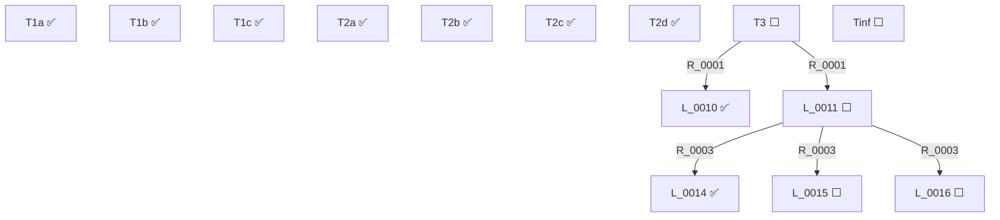

<!-- このファイルは core/status_gen.py が自動生成します。手で編集しないこと。 -->
# 研究状況: 任意の M3 空間は M1 空間か？

- 生成時刻: 2026-11-26 07:41:13
- Targets 承認ハッシュ: `198f3fa8f630b46d…`（承認者: Ruca-maths）
- 本日の支出: $5.95 / $10.00
- 受理済みファイルの整合性: OK

## 目標
| 段階 | 目標 | ノード | 状態 | 試行 (証明/分解/反証) |
|---|---|---|---|---|
| T1 | T1a: 局所有限族は closure-preserving | L_0001 | ✅ | 0/0/0 |
| T1 | T1b: M1 ⇒ M2 | L_0002 | ✅ | 0/0/0 |
| T1 | T1c: M2 ⇒ M3 | L_0003 | ✅ | 0/0/0 |
| T2 | T2a: M3 ⇔ stratifiable | L_0004 | ✅ | 0/0/0 |
| T2 | T2b: stratifiable ⇒ パラコンパクト | L_0005 | ✅ | 4/0/3 |
| T2 | T2c: stratifiable ⇒ 完全正規 | L_0006 | ✅ | 0/0/0 |
| T2 | T2d: 距離化可能 ⇒ M1 | L_0007 | ✅ | 0/0/0 |
| T3 | T3: M3 ⇒ M2 | L_0008 | ⬜ | 0/0/0 |
| Tinf | Tinf: 任意の M3 空間は M1 か | L_0009 | ⬜ | 4/5/5 |

## 補題
| ノード | 深さ | 状態 | 説明 |
|---|---|---|---|
| L_0010 | 1 | ✅ | M3 空間は stratification を持つ（Borges/Ceder の標準的な方向）。σ-cushioned pair-base 𝓟 = ⋃ 𝓟_n  |
| L_0011 | 1 | ⬜ | stratifiable（正則 T1）空間は σ-closure-preserving な quasi-base を持つ（Gruenhage 1976 'Str |
| L_0014 | 2 | ✅ | stratification から単調減少な stratifiable g-関数を作る。T1 なので {x} は閉。g n x = ⋂_{k ≤ n} G k  |
| L_0015 | 2 | ⬜ | 核心部（Junnila 1978 'Neighbornets' による stratifiable ⇒ M2 の証明の中心）：stratifiable な正則空間 |
| L_0016 | 2 | ⬜ | 推移的 neighbornet の列から σ-closure-preserving quasi-base を作る（易しい）。𝓑' n = {(⋃_{y∈A} V |

## 依存グラフ

## 実行中のリース
- prover-2: prove L_0016（残り 1730 秒）

## Red Team 監査報告（未レビュー。人間が確認すること）
- `memory/audits/20261126-051609-redteam-1.md`

